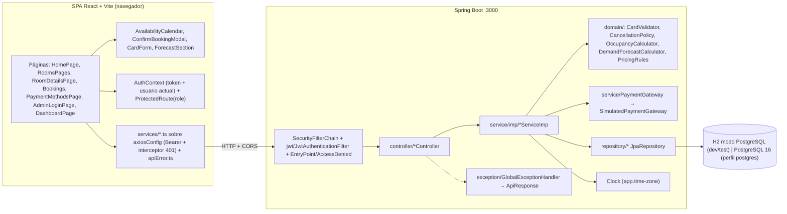
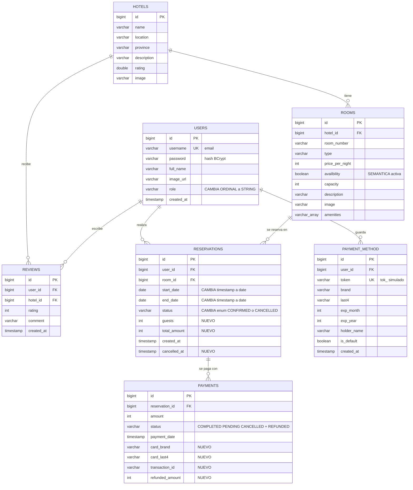

# Arquitectura — Hotel Reservation System (Sprint HU-00..HU-05)

> Versión 2.0 · 2026-10-28 · Base: `upstream/developer` integrada en `develop` (`950bff7`) — [ADR-007](adr/ADR-007-base-developer-en-lugar-de-main.md).
> Audiencia: el equipo (Developer / Reviewer / QA). Documentos hermanos: [API-CONTRACT.md](API-CONTRACT.md) (normativo para la API, incluye la matriz RBAC) · [ADRs](adr/) · [Backlog](../user-stories/README.md)

## 1. Restricciones de partida

No existe `architecture-constitution.md`. Hacen de constitución las decisiones del equipo:

| # | Restricción | ADR |
|---|-------------|-----|
| R0 | La base del proyecto es `upstream/developer`. No se rompen las rutas ni las formas que consume su frontend. | [ADR-007](adr/ADR-007-base-developer-en-lugar-de-main.md) |
| R1 | Spring Boot 3.3.2 / Java 17 / Maven wrapper, puerto 3000, paquete `app.mnhotel.hotel_reservation_system_backend`. | — |
| R2 | Convenciones de `developer`: `controller/`, `service/` + `service/imp/*ServiceImp`, `repository/`, `entity/`, `dto/` con builders, `request/`, `response/`, `enums/`, `jwt/`; rutas `/api/<recurso singular>/<verbo-recurso>`; mensajes en español. | — |
| R3 | JWT stateless (jjwt 0.11.5 ya presente), roles `USER`/`ADMIN` como autoridades sin prefijo, BCrypt. | [ADR-001](adr/ADR-001-autenticacion-jwt-stateless.md) |
| R4 | H2 en modo PostgreSQL para `test` y `dev` (con seed); PostgreSQL vía docker-compose (perfil `postgres`). Sin SQL nativo de Postgres. | [ADR-002](adr/ADR-002-h2-test-dev-postgres-real.md) |
| R5 | Pasarela simulada; nunca se guardan PAN ni CVV. | [ADR-003](adr/ADR-003-pasarela-simulada-tokenizacion.md) |
| R6 | Previsión determinista y testeable. | [ADR-004](adr/ADR-004-algoritmo-prevision-demanda.md) |
| R7 | Disponibilidad derivada de las reservas; solapamiento → 409. | [ADR-005](adr/ADR-005-disponibilidad-derivada-de-reservas.md) |
| R7b | `Clock` inyectable, zona del hotel y hora de check-in configurables. | [ADR-006](adr/ADR-006-reloj-zona-horaria-check-in.md) |
| R8 | Frontend React 18 + Vite 5 + TS + Tailwind + React Router 6. **Un solo cliente HTTP: axios** (`services/axiosConfig.ts`). Vitest + RTL. `recharts`. Calendario propio. | — |
| R9 | Dinero en **enteros** (USD sin decimales), como `Room.pricePerNight` y `Payment.amount` de `developer`. | — |

## 2. Diagnóstico del estado actual (`develop` @ `950bff7`)

Rutas relativas a `hotel-reservation-system-backend/src/main/java/app/mnhotel/hotel_reservation_system_backend/` (backend) y `hotel-reservation-system-frontend/src/` (frontend).

### 2.1 Backend

| # | Deuda | Ubicación | Impacto | HU |
|---|-------|-----------|---------|----|
| B1 | `requestMatchers(HttpMethod.GET).permitAll()`: **todo GET es público**, incluidos `/api/user/get-all`, `/api/user/get-user/{id}`, `/api/payment/get-all` y `/api/reservation/get-all` | `configuration/SecurityConfig.java` | Fuga de datos personales y de pagos | HU-04 |
| B2 | Sin reglas por rol: cualquier autenticado crea, edita o borra hoteles, habitaciones, usuarios y pagos | `configuration/SecurityConfig.java` | Un huésped puede alterar el inventario | HU-04 |
| B3 | Sin `AuthenticationEntryPoint`: el anónimo en ruta protegida recibe **403** (por defecto de Spring), no 401, y sin cuerpo | `configuration/SecurityConfig.java` | El front no distingue "inicia sesión" de "sin permiso" | HU-04 |
| B4 | `SECRET_KEY` HS256 fijo en el código | `jwt/JwtServiceImp.java` | Cualquiera con el repo firma tokens válidos | HU-04 |
| B5 | El filtro no captura `JwtException` (caducado, firma inválida) ni `UsernameNotFoundException` | `jwt/JwtAuthenticationFilter.java` | Token caducado → error 500/403 en vez de 401; en rutas públicas rompe la petición | HU-04 |
| B6 | `getAuthorities()` devuelve `"ADMIN"`/`"USER"` sin `ROLE_`; `role` sin `@Enumerated` → se guarda como **ORDINAL** (`ADMIN=0`, `USER=1`) | `entity/User.java`, `enums/RoleType.java` | `hasRole()` nunca coincidiría; reordenar el enum intercambia roles | HU-04 |
| B7 | Registro duplicado responde `400` con el mensaje **dentro del campo `token`**; sin validación de email ni de contraseña | `controller/AuthController.java`, `request/RegisterRequest.java` | Errores ilegibles; contraseñas triviales | HU-04 |
| B8 | No existe `GlobalExceptionHandler`; todos los controladores hacen `catch(Exception)` → 500 (o 204 en borrados no encontrados) | `controller/*Controller.java` | Un 404 o 400 de negocio llega como 500 | HU-00 (handler) + HU-04 (quitar `try/catch`) |
| B9 | `ReservationServiceImp.createReservation` toma `userId` del body y no valida solapamiento; `ReviewServiceImp` igual con `userId` | `service/imp/ReservationServiceImp.java`, `service/imp/ReviewServiceImp.java` | Reservas/reseñas a nombre de otro; overbooking | HU-04 (acceso), HU-02 (solapamiento) |
| B10 | `Reservation.startDate/endDate` como `LocalDateTime`, `status` `String` libre; sin `guests` ni `totalAmount` | `entity/Reservation.java`, `dto/ReservationDTO.java` | Noches ambiguas, estados inválidos | HU-02, HU-01 |
| B11 | Disponibilidad como flag manual `availbility` (mal escrito; el DTO lo llama `availability`) | `entity/Room.java`, `dto/RoomDTO.java` | No modela fechas | HU-02 (se redefine como "activa") |
| B12 | `Room.amenities` es `List<String>` con `@Column` (mapeo ARRAY de Hibernate 6) | `entity/Room.java` | Portabilidad H2/Postgres sin probar | HU-00 (primer test de caracterización) |
| B13 | `application.properties` con `root/root` fijos y `show-sql=true`; sin perfiles; el único test necesita PostgreSQL | `src/main/resources/application.properties`, `src/test/.../HotelReservationSystemApplicationTests.java` | Sin CI posible | HU-00 |
| B14 | `bin/` de Eclipse versionado | `hotel-reservation-system-backend/bin/` | Ruido | HU-00 |
| B15 | SDK de Mercado Pago y `MercadoPagoConfig` sin uso; `GoogleUserDTO` y `registerOrLoginWithGoogle` comentados | `pom.xml`, `configuration/MercadoPagoConfig.java`, `service/imp/UserServiceImp.java` | Superficie de dependencias sin valor; contradice ADR-003 | HU-00 |
| B16 | `@Data` de Lombok en entidades con relaciones bidireccionales; `User.orElseThrow()` devuelve `null` | `entity/*.java` | `toString`/`hashCode` recursivos; código engañoso | Cada HU que toque la entidad |
| B17 | `@CrossOrigin` solo en `Auth`, `Hotel`, `Room` y `UserController`; `Reservation`, `Payment` y `Review` sin CORS | `controller/*.java` | Llamadas del navegador a esas rutas fallan por CORS | HU-00 (CORS central) |

Hallazgo verificado: la **enumeración por tiempos en el login** queda mitigada hoy porque `DaoAuthenticationProvider` (`configuration/ApplicationConfig.java`) ejecuta un hash ficticio cuando el usuario no existe. HU-04 lo fija con un test de regresión (no hay que reimplementarlo).

### 2.2 Frontend

| # | Deuda | Ubicación | HU |
|---|-------|-----------|----|
| F1 | `tsc -b` no compila (unos 20 errores según la revisión del coordinador; incluye el import `Sidebars/SidebarFilter` frente al archivo `SideBarFilter.tsx`). No se pudo re-ejecutar aquí porque el worktree no tiene `node_modules` | `pages/RoomsPages.tsx` y otros | HU-00 |
| F2 | Sin tests ni Vitest | — | HU-00 |
| F3 | `hotelService.ts` y `authService.ts` usan `fetch`; las altas y ediciones de hotel **no envían el token** | `services/hotelService.ts`, `services/authService.ts` | HU-04 (migrar a axios) |
| F4 | `ProtectedRoute` solo comprueba que haya token: un USER entra en `/admin/dashboard`. `AdminLoginPage` no verifica el rol | `routes/ProtectedRoute.tsx`, `pages/AdminLoginPage.tsx`, `contexts/AuthContext.tsx` | HU-04 |
| F5 | Sin interceptor de respuesta: un 401 no cierra la sesión | `services/axiosConfig.ts` | HU-04 |
| F6 | `ConfirmBookingModal` pide nombre, teléfono y fechas y no llama a la API; `RoomDetailsPage` muestra "Available/Not Available" según el flag | `components/Modals/ConfirmBookingModal.tsx`, `pages/RoomDetailsPage.tsx` | HU-02, HU-01 |
| F7 | `/bookings` es una lista fija y no está protegida | `pages/Bookings.tsx`, `App.tsx` | HU-05 |
| F8 | El panel admin muestra mocks: `Dashboard` (Lorem ipsum), `BookingTable` y `PaymentTable` con arrays fijos | `components/Admin/Dashboard/Dashboard.tsx`, `components/Admin/Tables/*` | HU-03 (Dashboard) |
| F9 | `CardRoomWithHotel` enlaza a `/productDetail`, ruta que no existe | `components/Cards/CardRoomWithHotel.tsx` | HU-02 |
| F10 | Los `get-all` existentes responden `204` sin cuerpo y `fetchRooms` devuelve `''` | `services/roomService.ts` | HU-00 (caracterizar), HU-02 (tolerar) |

### 2.3 Qué se porta del trabajo archivado sobre `main`

Ramas `origin/archive/main-HU-00`, `archive/main-HU-04` y `archive/main-HU-02` (detalle en [HU-00](../user-stories/HU-00.md)): `.github/workflows/ci.yml`, `docker-compose.yml`, `application-{dev,postgres}.properties`, `src/test/resources/application-test.properties`, `configuration/ClockConfig.java`, `configuration/DevDataSeeder.java` (adaptado), `exception/{BusinessException,ConflictException,GlobalExceptionHandler}.java`, `response/ApiResponse.java`, `domain/OccupancyCalculator.java` (+ test), `src/test/.../FixedClockConfig.java`, `components/calendar/{AvailabilityCalendar.tsx,calendarUtils.ts,use-availability.ts}` (adaptados a `roomService`), `src/test/setup.ts`. **No** se portan `api/client.ts`, `types/api.ts`, `context/AuthContext.tsx` ni las páginas Login/Register/Checkout del archivo: duplicarían lo que ya tiene `developer`.

## 3. Arquitectura objetivo

### 3.1 Componentes

Principios:
- Lógica pura en `domain/` (sin Spring ni JPA), probada con JUnit puro.
- Controladores **sin `try/catch`**: lanzan `ResourceNotFoundException`/`BusinessException(status, code, message)` y los traduce `GlobalExceptionHandler`.
- "Dueño" se comprueba en el servicio con el usuario del token (`findByIdAndUserId`); los roles, en `SecurityConfig` con `hasAuthority`.
- Tiempo inyectado: `LocalDate.now(clock)`; prohibido sin argumento.

### 3.2 Paquetes backend nuevos o modificados

| Paquete | Contenido | HU |
|---------|-----------|----|
| `configuration/` | `SecurityConfig` (RBAC, CORS, entry point, `/error`), `ClockConfig`, `DevDataSeeder` (`@Profile("dev")`), `AdminBootstrap` (perfil `postgres`) | HU-00, HU-04 |
| `jwt/` | `JwtServiceImp` con secreto de `app.jwt.secret` y `Clock`; filtro tolerante a tokens inválidos | HU-04 |
| `exception/` | `BusinessException`, `ConflictException`, `GlobalExceptionHandler` | HU-00 |
| `domain/` | `OccupancyCalculator`, `CardValidator`, `CancellationPolicy`, `DemandForecastCalculator`, `PricingRules` | HU-02, HU-01, HU-05, HU-03 |
| `controller/` | `PaymentMethodController`, `AnalyticsController`; métodos nuevos en `RoomController` y `ReservationController` | HU-01..HU-05 |
| `service/` + `imp/` | `PaymentMethodService`, `AnalyticsService`, `PaymentGateway` (+ `SimulatedPaymentGateway`); métodos nuevos en `RoomService` y `ReservationService` | HU-01..HU-05 |
| `enums/` | `RoleType` (pasa a STRING), `ReservationStatus`, `PaymentStatus` (+`REFUNDED`), `CardBrand` | HU-04, HU-02, HU-01 |

### 3.3 Frontend objetivo

| Ruta | Página | Acceso | HU |
|------|--------|--------|----|
| `/` | `HomePage` (el `Header` contiene los modales de login/registro de `LoginPage`/`RegisterPage`) | Público | — |
| `/rooms` | `RoomsPages` (`fetchRooms({activeOnly: true})`) | Público | HU-02 |
| `/roomDetail/:id` | `RoomDetailsPage` + `AvailabilityCalendar`; "Book now" abre `ConfirmBookingModal` (pago) | Ver: público · Reservar: USER | HU-02, HU-01 |
| `/payment-methods` | `PaymentMethodsPage` (nueva), enlazada desde `ProfileCircle` | USER | HU-01 |
| `/bookings` | `Bookings` con datos reales y cancelación | USER | HU-05 |
| `/admin/login` | `AdminLoginPage` (rechaza cuentas no ADMIN) | Público | HU-04 |
| `/admin/dashboard` | `DashboardPage`; la pestaña `dashboard` muestra la previsión | ADMIN | HU-03, HU-04 |
| `/about` | `AboutPage` | Público | — |

- `ProtectedRoute` recibe `role?: 'ADMIN' | 'USER'`. Sin sesión: rutas de huésped → `/?login=1&redirect=<ruta>` (el `Header` abre el modal de login); rutas admin → `/admin/login`. Con rol insuficiente → `/`.
- `AuthContext` añade `user: UserDTO | null` (de `GET /api/user/current` al arrancar y tras el login) e `isAdmin`.
- `axiosConfig.ts`: interceptor de respuesta para 401; `services/apiError.ts` traduce errores de axios a `{status, code, message, errors}`.

## 4. Modelo de datos

### 4.1 Diagrama ER objetivo

### 4.2 Cambios por entidad y HU

Criterio: impacto mínimo en el frontend de `developer`. Sin renombrar campos que use una pantalla; los cambios de tipo solo donde ninguna pantalla consume el campo.

| Entidad | Cambio | Impacto en el frontend | HU |
|---------|--------|------------------------|----|
| `User` | `role` con `@Enumerated(EnumType.STRING)`; relaciones con `@ToString.Exclude`; eliminar `orElseThrow()` | Ninguno: el JSON ya serializa `"ADMIN"`/`"USER"`. En Postgres con datos previos la única vía soportada es recrear el volumen (`docker compose down -v`): la columna es numérica y `ddl-auto` no cambia su tipo | HU-04 |
| `Room` | **Sin cambios estructurales.** `availbility`/`availability` pasa a significar "activa / a la venta" | `RoomDetailsPage` deja de mostrar "Available/Not Available" (lo sustituye el calendario) | HU-02 |
| `Reservation` | `startDate`/`endDate` `LocalDateTime` → `LocalDate` (mismos nombres y columnas); `status` → `enums/ReservationStatus {CONFIRMED, CANCELLED}` (STRING); índice `(room_id, status, start_date, end_date)` | Ninguno (nadie consume `ReservationDTO`; `BookingTable` es un mock) | HU-02 |
| `Reservation` | `guests` (`Integer`), `totalAmount` (`Integer`) | Ninguno | HU-01 |
| `Reservation` | `cancelledAt` (`LocalDateTime`) | Ninguno | HU-05 |
| `Payment` | `cardBrand`, `cardLast4`, `transactionId`, `refundedAmount` (`Integer`, 0); `PaymentStatus` + `REFUNDED` | Aditivo en `PaymentDTO` | HU-01 |
| `PaymentMethod` | **Nueva**: `user`, `token` (único), `brand` (`enums/CardBrand`), `last4`, `expMonth`, `expYear`, `holderName`, `isDefault`, `createdAt` | Nueva página | HU-01 |
| `Hotel`, `Review` | Sin cambios | — | — |

Decisiones:
- `Payment` copia marca y últimos 4: no referencia a `PaymentMethod`, así que borrar una tarjeta no rompe el historial.
- Las fases de una reserva (`UPCOMING`, `IN_STAY`, `COMPLETED`) se derivan, no se guardan.
- En Postgres, `ddl-auto=update` no cambia el tipo de `start_date`/`end_date`: recrear el volumen (ADR-002).

### 4.3 Datos semilla y cuentas ADMIN

| Perfil | Mecanismo | Contenido |
|--------|-----------|-----------|
| `dev` | `DevDataSeeder` (`Random(42)`, fechas relativas al `Clock`, solo si `users` está vacía) | `admin@hotel.com` / `Admin12345` (ADMIN), `demo@hotel.com` / `Demo12345` (USER), 5 huéspedes; 2 hoteles, 10 habitaciones con `image` y `amenities`; reservas futuras salteadas (HU-02); VISA ••••4242 de `demo` (HU-01); 24 meses de histórico estacional (HU-03); reservas de `demo` para cancelar (HU-05) |
| `test` | Cada test crea sus datos | — |
| `postgres` | `AdminBootstrap`: si no existe ningún ADMIN y están definidas `ADMIN_USERNAME` y `ADMIN_PASSWORD`, crea esa cuenta al arrancar. Sin variables, no crea nada y lo avisa en el log | Una cuenta ADMIN |

Ni el registro público ni `/api/user/registration-user` pueden crear un ADMIN; esta tabla es la **única** vía.

## 5. Seguridad

La matriz completa endpoint × rol está en [API-CONTRACT §13](API-CONTRACT.md#13-matriz-rbac). Controles:

| Riesgo | Control | HU |
|--------|---------|----|
| GET públicos indiscriminados | Lista explícita de rutas públicas; `anyRequest().authenticated()`; reglas `hasAuthority("ADMIN")` por ruta | HU-04 |
| Datos ajenos (BOLA) | Servicios filtran por el usuario del token; ajeno → 404. `userId` del body se ignora en reservas y reseñas | HU-04, HU-01, HU-05 |
| Escalada de privilegios | Registro y alta admin fuerzan `USER`; `update-user` nunca cambia `role`; rol leído de la BD, no del token | HU-04 |
| Secreto JWT | `app.jwt.secret` desde `JWT_SECRET` (Base64, ≥ 256 bits); `dev`/`test` con valor fijo no productivo; `postgres` sin valor por defecto (no arranca sin él) | HU-04 |
| Tokens inválidos | El filtro captura `JwtException` y `UsernameNotFoundException` y sigue como anónimo → 401 en protegidas | HU-04 |
| 401 frente a 403 | `AuthenticationEntryPoint` (401) y `AccessDeniedHandler` (403) con el sobre `ApiResponse` | HU-04 |
| Enumeración en login | Mismo 401 y mismo mensaje; `DaoAuthenticationProvider` mantiene el hash ficticio (test de regresión) | HU-04 |
| Errores 4xx convertidos en 500 | Sin `try/catch` genéricos en los controladores; `GlobalExceptionHandler` único | HU-00, HU-04 |
| Datos de tarjeta | ADR-003: sin PAN/CVV persistidos ni en logs; el token no se expone | HU-01 |
| CORS | Central (`http://localhost:5173`), sin `@CrossOrigin` sueltos | HU-00 |
| CSRF | Deshabilitado (stateless, Bearer, sin cookies) | — |
| Fuerza bruta | Fuera de alcance (riesgo aceptado) | — |

## 6. Estrategia de pruebas

| Nivel | Herramienta | Qué cubre |
|-------|-------------|-----------|
| **Caracterización** | `@SpringBootTest` + MockMvc, perfil `test` | Estado y forma **actuales** de cada endpoint existente antes de modificarlo (HU-00). Cuando una HU cambia un comportamiento, actualiza la expectativa en el mismo PR para que el cambio quede visible en la revisión. |
| Unidad (dominio) | JUnit 5 + AssertJ | `CardValidator`, `CancellationPolicy`, `OccupancyCalculator`, `DemandForecastCalculator`, `PricingRules` (vectores de ADR-004) |
| Unidad (servicio) | Mockito | Orden de validaciones de la reserva; 402 sin persistencia; timing-guard del login |
| Repositorio | `@DataJpaTest` (H2) | Solapamiento, noches ocupadas, consultas por dueño |
| API / seguridad | MockMvc + `Clock` fijo (`FixedClockConfig`) | Contrato (estado + `code`), matriz RBAC completa (test parametrizado), JWT negativos. Con `@WithMockUser(authorities = "ADMIN")`, **no** `roles =` (las autoridades no llevan `ROLE_`) |
| Frontend | Vitest + RTL + user-event + jsdom; axios simulado con `vi.mock('../services/...')` | Calendario, modal de reserva, Bookings, ProtectedRoute, Dashboard de previsión (`ResizeObserver` simulado) |
| Manual (QA) | Checklist de cada HU con el perfil `dev` | Evidencia en el PR; una pasada con el perfil `postgres` antes de fusionar a `main` |

Puertas de CI (`.github/workflows/ci.yml`, portado en HU-00): `backend` → `./mvnw -B test`; `frontend` → `npm ci && npm test && npm run build`. Ambas bloquean el PR. Todo criterio de aceptación referencia al menos un test que corre en una de ellas.

## 7. Flujo de trabajo

- `main` ← `develop` ← `feature/HU-0X-<slug>` (ramas en [README](../user-stories/README.md)).
- PR a `develop`: CI en verde, 1 revisión (Reviewer), checklist de QA y `Refs: HU-0X`.
- Si hay que cambiar el contrato, primero se edita `API-CONTRACT.md` en un PR.

## 8. Fuera de alcance

- Aplicar automáticamente los precios sugeridos o activar habitaciones desde la previsión (el ADMIN lo hace a mano con `update-room`).
- Pagos reales (se retira el SDK de Mercado Pago), login con Google, refresh tokens, recuperación de contraseña, rate limiting.
- Migraciones Flyway/Liquibase.
- Cambio de contraseña (`ChangePasswordModal` sigue sin backend).
