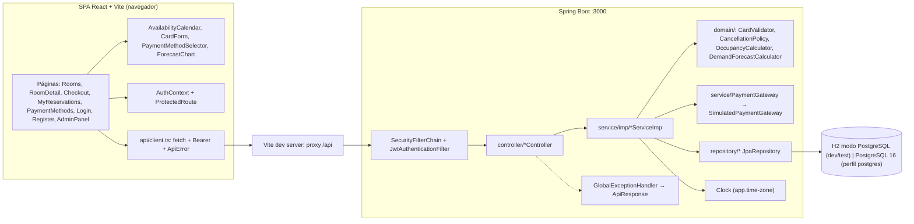
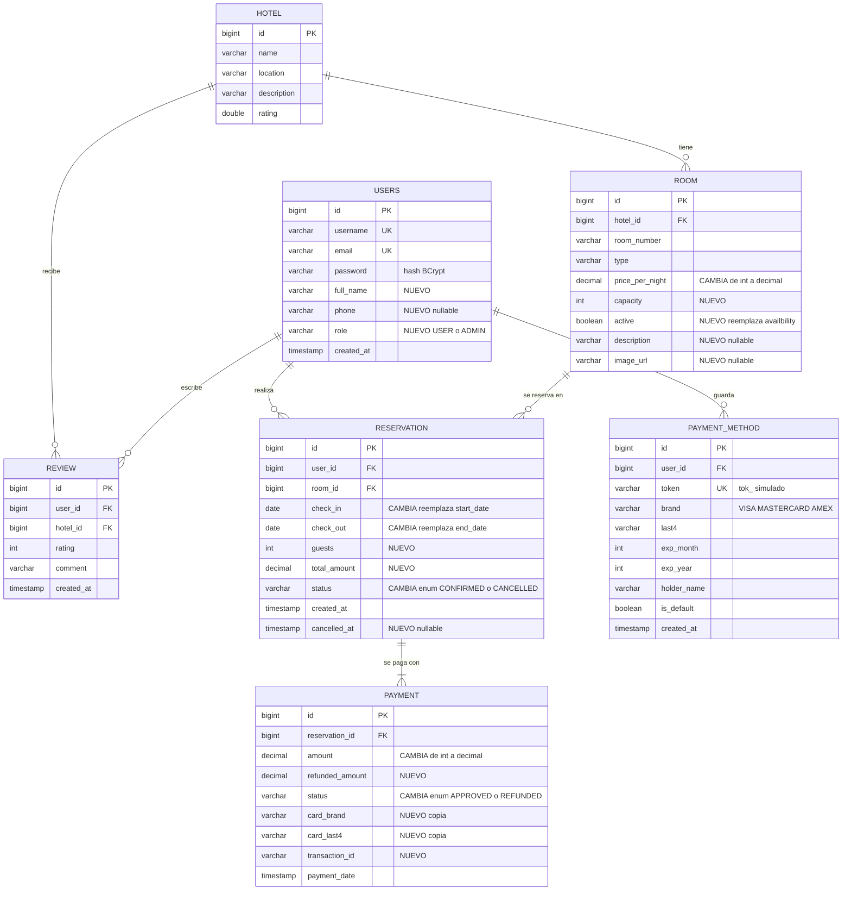

# Arquitectura — Hotel Reservation System (Sprint HU-00..HU-05)

> Versión 1.0 · 2026-10-28 · Audiencia: el equipo (Developer / Reviewer / QA).
> Documentos hermanos: [API-CONTRACT.md](API-CONTRACT.md) (normativo para la API) · [ADRs](adr/) · [Backlog](../user-stories/README.md)

## 1. Restricciones de partida

No existe `architecture-constitution.md` en el repositorio. Funcionan como constitución las decisiones del equipo (2026-10-28):

| # | Restricción | ADR |
|---|-------------|-----|
| R1 | Backend Spring Boot 3.3.2 / Java 17 / Maven wrapper, puerto 3000, paquete `app.mnhotel.hotel_reservation_system_backend`. | — |
| R2 | Convenciones del repo: `controller/`, `service/` (interfaces) + `service/imp/*ServiceImp`, `repository/`, `entity/` (Lombok), `dto/` con builders, `ApiResponse` con mensajes en español. | — |
| R3 | Autenticación stateless con JWT (jjwt 0.12.x), roles `USER`/`ADMIN`, BCrypt. | [ADR-001](adr/ADR-001-autenticacion-jwt-stateless.md) |
| R4 | H2 en modo PostgreSQL para `test` y `dev` (con datos semilla); PostgreSQL real vía docker-compose (perfil `postgres`). Sin SQL nativo específico de Postgres. | [ADR-002](adr/ADR-002-h2-test-dev-postgres-real.md) |
| R5 | Pasarela de pago **simulada**. Nunca se guarda número completo ni CVV. Luhn al tokenizar. | [ADR-003](adr/ADR-003-pasarela-simulada-tokenizacion.md) |
| R6 | Previsión determinista y testeable por unidades. | [ADR-004](adr/ADR-004-algoritmo-prevision-demanda.md) |
| R7 | La disponibilidad se deriva de las reservas; el solapamiento se valida en el servidor (409). | [ADR-005](adr/ADR-005-disponibilidad-derivada-de-reservas.md) |
| R7b | Tiempo inyectado (`Clock`) con zona del hotel y hora de check-in configurables. | [ADR-006](adr/ADR-006-reloj-zona-horaria-check-in.md) |
| R8 | Frontend SPA React 18 + Vite 5 + TS + Tailwind 3 + React Router 6 (sin Next.js). Proxy `/api` → `:3000`. Vitest + RTL. `recharts`. Calendario propio con Tailwind. | — |

## 2. Diagnóstico del estado actual

Línea base: `upstream/main` @ `2f82bdb` (PR #22). Estado en la rama `feature/HU-00-base-tecnica` @ `38c7453`.

### 2.1 Backend (`hotel-reservation-system-backend/`)

| # | Deuda | Ubicación | Impacto | Estado |
|---|-------|-----------|---------|--------|
| B1 | Spring Security y `spring-security-test` comentados; sin `jjwt` | `pom.xml` | Toda la API es pública | HU-04 (en curso) |
| B2 | Clases vacías: `SecurityConfig`, `UserController`; `AuthServiceImp.createUser` devuelve `null`; `RoomService`, `ReservationService`, `PaymentService`, `UserService` y sus `*ServiceImp` sin métodos | `configuration/`, `controller/`, `service/`, `service/imp/` | Solo funciona el CRUD de hoteles | HU-01..HU-05 |
| B3 | Credenciales `root/root` fijas, `ddl-auto=update`, `show-sql=true`, `BasicBinder=TRACE` (vuelca a log los parámetros SQL: hashes, datos de tarjeta) | `src/main/resources/application.properties` | Fuga de datos sensibles en logs | Resuelto en `4dca3a6` (variables `DB_URL/DB_USERNAME/DB_PASSWORD`, logs en INFO/WARN). Persiste el valor por defecto `root` en `application-postgres.properties` (aceptable solo en local). |
| B4 | `contextLoads` necesitaba PostgreSQL levantado | `src/test/.../HotelReservationSystemApplicationTests.java` | CI imposible | Resuelto en `bf107a7` (perfil `test` con H2) |
| B5 | Carpeta `bin/` de Eclipse versionada (con `.class` y copia del `pom.xml`) | `hotel-reservation-system-backend/bin/` | Ruido, confusión de `pom` | Resuelto en `091d71b` |
| B6 | Disponibilidad como flag manual, nombre mal escrito | `entity/Room.java` (`availbility`), `dto/RoomDTO.java` (`availability`) | Estado incoherente con las reservas; el DTO no coincide con la entidad | HU-02 (se reemplaza por `active`, ver §4) |
| B7 | Fechas de reserva como `LocalDateTime`, `status` como `String` libre, dinero como `Integer` | `entity/Reservation.java`, `entity/Payment.java`, `entity/Room.java` | Ambigüedad de noches, estados inválidos, redondeos | HU-02/HU-01 |
| B8 | `@Data` de Lombok en entidades con relaciones bidireccionales (`Hotel.rooms`↔`Room.hotel`, `User.reservations`↔`Reservation.user`) | `entity/*.java` | `toString`/`hashCode` recursivos → `StackOverflowError` al loguear o usar `Set` | Cada HU que toque una entidad añade `@ToString.Exclude` y `@EqualsAndHashCode.Exclude` en las relaciones |
| B9 | `@JsonIgnoreProperties` sin argumentos (no hace nada) | `entity/Hotel.java` | Falsa sensación de protección; las entidades no deben serializarse | Regla: los controladores devuelven siempre DTOs |
| B10 | `try/catch(Exception)` genéricos con `printStackTrace` y 500 sin cuerpo; `deleteHotel` captura `RuntimeException` pero el servicio lanza `Exception` (no encontrado → 500) | `controller/HotelController.java`, `service/imp/HotelServiceImp.java` | Errores no tipados para el front | `GlobalExceptionHandler` creado en `4dca3a6`; falta completar el catálogo de `code` (HU-00) |
| B11 | `@CrossOrigin` por controlador | `controller/HotelController.java` | Duplicación al crecer | CORS central en `SecurityConfig` (HU-04); el proxy de Vite lo hace innecesario en dev |
| B12 | Esquema por `ddl-auto`, sin migraciones | `application.properties` | Renombrar columnas deja columnas huérfanas en Postgres | Deuda aceptada para el sprint: recrear el volumen (`docker compose down -v`) |

### 2.2 Frontend (`hotel-reservation-system-frontend/`)

| # | Deuda | Ubicación | Estado |
|---|-------|-----------|--------|
| F1 | 100 % maqueta: precios y textos fijos (`$5555`, `$150 / night`, Lorem ipsum) | `components/CardRoom.tsx`, `components/RoomDetailComponent.tsx`, `components/Dashboard.tsx` | HU-02, HU-03 |
| F2 | Sin cliente HTTP, sin tipos de API, sin estado de sesión | `src/` | HU-00 (cliente + tipos), HU-04 (sesión) |
| F3 | El detalle no recibe id (`/productDetail`); `CardRoom` enlaza siempre a la misma ruta | `App.tsx`, `components/CardRoom.tsx` | HU-02 (`/rooms/:id`) |
| F4 | Dos `<input type="date">` sin validación ni disponibilidad; botón "Reserve" sin acción | `components/RoomDetailComponent.tsx` | HU-02 / HU-01 |
| F5 | Import `../components/SideBar` contra archivo `Sidebar.tsx` e imports `React` sin usar con `noUnusedLocals` (rompían `tsc -b`) | `pages/AdminPanel.tsx`, `pages/*.tsx` | Resuelto en `0d162ad` (verificado: `tsc --noEmit -p tsconfig.app.json` sale con 0) |
| F6 | Atributos SVG `fill-rule` en JSX (aviso de React) | `components/RoomDetailComponent.tsx` | Limpieza oportunista en HU-02 |
| F7 | Sin tests | — | Resuelto en `bf107a7` (Vitest + RTL + jsdom, `npm test`) |
| F8 | README raíz pide `yarn` y menciona Mercado Pago/Stripe; el repo usa `npm` (`package-lock.json`) y no hay integración de pago | `README.md` | HU-00 |

### 2.3 Nota sobre `upstream/developer`

`upstream/developer` tiene 32 commits más que `upstream/main` (auth JWT, controladores de Room/Reservation/Payment/Review, SDK de Mercado Pago, login con Google, páginas Login/Register/Bookings). **El equipo decidió partir de `main`.** Se puede consultar como referencia, pero no se mezcla: no tiene tests y su pago real contradice R5.

## 3. Arquitectura objetivo

### 3.1 Componentes

Principios:
- **Lógica pura en `domain/`** (sin Spring ni JPA): recibe datos y un `Clock`/fecha, devuelve resultados. Es donde viven las reglas con más casos borde y se prueba con JUnit puro.
- **Servicios** orquestan: transacción, repositorios, pasarela, mapeo a DTO. Siguen el patrón `service/XService` + `service/imp/XServiceImp`.
- **Controladores** delgados: validan con `@Valid`, delegan y devuelven DTOs. Sin `try/catch`: las excepciones de negocio (`BusinessException(code, status, message)`) las traduce `GlobalExceptionHandler`.
- **Tiempo inyectado**: un bean `Clock` con zona `app.time-zone`. Prohibido `LocalDate.now()` sin argumento. En tests se sustituye por `Clock.fixed(...)`.

### 3.2 Paquetes backend nuevos o modificados

| Paquete | Contenido nuevo | HU |
|---------|-----------------|----|
| `configuration/` | `SecurityConfig`, `ClockConfig`, `DevDataSeeder` (`@Profile("dev")`) | HU-00, HU-04 |
| `security/` | `JwtService`, `JwtAuthenticationFilter`, `RestAuthenticationEntryPoint`, `RestAccessDeniedHandler` | HU-04 |
| `domain/` | `CardValidator`, `CancellationPolicy`, `OccupancyCalculator`, `DemandForecastCalculator`, `PricingRules` | HU-01, HU-05, HU-03 |
| `controller/` | `AuthController`, `RoomController`, `PaymentMethodController`, `ReservationController`, `AnalyticsController` | todas |
| `service/` + `imp/` | `AuthService`, `RoomService`, `PaymentMethodService`, `ReservationService`, `AnalyticsService`, `PaymentGateway` (+ `SimulatedPaymentGateway`) | todas |
| `exception/` | `BusinessException` (lleva `code` y `HttpStatus`), `GlobalExceptionHandler` ampliado | HU-00 |
| `response/` | `ApiResponse{message, code?, errors?}`, `AuthResponse{token, user}` | HU-00, HU-04 |

### 3.3 Frontend objetivo

| Ruta | Página | Acceso | HU |
|------|--------|--------|----|
| `/` | Home (sin cambios) | Público | — |
| `/products` | Listado de habitaciones desde `GET /api/rooms` | Público | HU-02 |
| `/rooms/:id` | Detalle + `AvailabilityCalendar` (sustituye a `/productDetail`, que redirige a `/products`) | Público | HU-02 |
| `/rooms/:id/checkout?checkIn&checkOut&guests` | Resumen + pago (tarjeta guardada o nueva) | USER | HU-01 |
| `/login`, `/register` | Formularios de sesión (`?redirect=` para volver) | Público | HU-04 |
| `/account/payment-methods` | Gestión de tarjetas guardadas | USER | HU-01 |
| `/my-reservations` | Historial y cancelación | USER | HU-05 |
| `/admin` | Panel; nueva pestaña "Previsión" | ADMIN | HU-03 |
| `/about` | Sin cambios | Público | — |

Estructura: `src/types/api.ts` (copiado de API-CONTRACT §1), `src/api/{client,auth,rooms,paymentMethods,reservations,analytics}.ts`, `src/context/AuthContext.tsx`, `src/routes/ProtectedRoute.tsx`, `src/components/calendar/{AvailabilityCalendar.tsx,calendarUtils.ts}`, `src/components/payment/{CardForm,PaymentMethodSelector}.tsx`, `src/components/admin/ForecastChart.tsx`.

- `api/client.ts`: añade `Authorization` si hay token; si la respuesta no es 2xx lanza `ApiError` con `status` y `code`; ante `401 UNAUTHORIZED` en ruta protegida limpia la sesión y navega a `/login?redirect=<ruta>`.
- El token se guarda en `localStorage` con la clave `hotelmn.token` (implementado en `23d1b00`); el `UserProfile` se recupera con `GET /api/auth/me` al cargar la SPA (trade-off en ADR-001).

## 4. Modelo de datos

### 4.1 Diagrama ER objetivo

### 4.2 Cambios por entidad y HU que los introduce

Regla de trabajo: cada campo lo añade **la primera HU que lo necesita**, en su rama. Las HU posteriores solo agregan consultas y comportamiento. Como el orden de implementación es secuencial, no hay dos ramas editando la misma entidad a la vez.

| Entidad | Cambio | Tipo Java | HU |
|---------|--------|-----------|----|
| `User` | `fullName` (obligatorio), `phone` (opcional), `role` | `String`, `String`, enum `entity/Role {USER, ADMIN}` (`@Enumerated(STRING)`, por defecto `USER`) | HU-04 |
| `User` | `password` con `@JsonIgnore`; `username`/`email` en minúsculas | — | HU-04 |
| `Room` | `availbility` → `active` (habitación a la venta; **no** es disponibilidad) | `Boolean`, por defecto `true` | HU-02 |
| `Room` | `capacity` (huéspedes máx.), `description`, `imageUrl` | `Integer`, `String`, `String` | HU-02 |
| `Room` | `pricePerNight` `Integer` → `BigDecimal` (`precision=10, scale=2`) | `BigDecimal` | HU-02 |
| `Reservation` | `startDate/endDate` (`LocalDateTime`) → `checkIn/checkOut` | `LocalDate` | HU-02 |
| `Reservation` | `guests`, `totalAmount`, `status` como enum `entity/ReservationStatus {CONFIRMED, CANCELLED}` | `Integer`, `BigDecimal`, enum | HU-02 |
| `Reservation` | `cancelledAt` | `LocalDateTime` | HU-05 |
| `Payment` | `amount` → `BigDecimal`; `status` enum `entity/PaymentStatus {APPROVED, REFUNDED}`; `cardBrand`, `cardLast4`, `transactionId` | — | HU-01 |
| `Payment` | `refundedAmount` (por defecto `0.00`) | `BigDecimal` | HU-01 (se crea en `0.00`), usado en HU-05 |
| `PaymentMethod` | **Nueva**: `user`, `token` (único), `brand` (enum `entity/CardBrand {VISA, MASTERCARD, AMEX}`), `last4`, `expMonth`, `expYear`, `holderName`, `isDefault`, `createdAt` | — | HU-01 |

Decisiones de modelo:
- `Payment` **no** referencia a `PaymentMethod`: copia marca y últimos 4. Así borrar una tarjeta no rompe el historial ni requiere FK con `ON DELETE SET NULL`.
- Las fases (`UPCOMING`, `IN_STAY`, `COMPLETED`) **no** se persisten: se derivan de las fechas y del `Clock` (API-CONTRACT §5.2).
- Consultas de ocupación en JPQL o agregación en Java. Nada de `date_trunc` ni `generate_series` (R4).
- Nombres de columna seguros en H2: evitar `value`, `year`, `month`, `day`, `user`, `order`, `key` (por eso `exp_year`, `exp_month`, tabla `users`).

### 4.3 Datos semilla (perfil `dev`, `DevDataSeeder`)

Deterministas (`new Random(42)`, fechas relativas a `LocalDate.now(clock)`). Se cargan solo si la tabla `users` está vacía.

| Bloque | Contenido | HU |
|--------|-----------|----|
| Usuarios | `admin` / `Admin12345` (ADMIN); `demo` / `Demo12345` (USER); 5 huéspedes sintéticos | HU-04 |
| Hoteles | 2 hoteles (esqueleto del seeder) | HU-00 |
| Habitaciones | 10 habitaciones (tipos `SIMPLE`, `DOBLE`, `SUITE`; capacidad 1–4; precios 80.00–220.00) | HU-02 |
| Reservas futuras | Ocupación salteada en los próximos 60 días (para ver días ocupados en el calendario) | HU-02 |
| Tarjeta demo | `demo` con VISA ••••4242 predeterminada (token `tok_` generado) | HU-01 |
| Histórico | 24 meses completos de reservas `CONFIRMED` por habitación con estacionalidad (pico jul–ago y dic, valle may y sep–oct) + tendencia de +0.5 pp/mes | HU-03 |
| Reservas de `demo` | Una a > 48 h (reembolsable), una que empieza mañana (no reembolsable), una pasada, una cancelada | HU-05 |

Las credenciales semilla son solo para desarrollo local; el perfil `postgres` no ejecuta el seeder.

## 5. Seguridad

### 5.1 Matriz de acceso

| Acceso | Rutas |
|--------|-------|
| **Público** | `POST /api/auth/register`, `POST /api/auth/login`, `GET /api/rooms`, `GET /api/rooms/{id}`, `GET /api/rooms/{id}/availability`, `GET /api/hotel/get-all`, `GET /api/hotel/get-hotel/{id}`, `OPTIONS /**`, `/h2-console/**` (solo perfil `dev`) |
| **USER** (cualquier usuario autenticado; ADMIN incluido) | `GET /api/auth/me`, `/api/payment-methods/**`, `/api/reservations/**` |
| **ADMIN** | `/api/admin/**`, `POST /api/hotel/registration-hotel`, `PUT /api/hotel/update-hotel/{id}`, `DELETE /api/hotel/delete-hotel/{id}` |
| Resto | `authenticated()` (una ruta inexistente sin token responde 401, con token 404) |

### 5.2 Controles

| Riesgo | Control |
|--------|---------|
| Acceso a datos ajenos (BOLA) | Toda consulta de reservas/tarjetas filtra por el `userId` del token (`findByIdAndUserId`). Si es ajena responde 404. Test MockMvc con dos usuarios por endpoint. |
| Asignación masiva | DTOs de request explícitos; `role` nunca se lee del body. |
| Contraseñas | BCrypt (coste 10), longitud 8–72; `password` con `@JsonIgnore`; login con mensaje genérico. |
| JWT | HS256, secreto `app.jwt.secret` desde `JWT_SECRET` (Base64, ≥ 256 bits). `dev`/`test` traen un valor fijo no productivo; `postgres` **no** tiene valor por defecto (falla al arrancar si falta). Expiración 24 h. |
| Datos de tarjeta | Ver ADR-003: no se persisten PAN ni CVV; prohibido loguear bodies de `/api/payment-methods` y `/api/reservations`; `token` nunca sale en respuestas. |
| Errores | Sin stack traces en respuestas; `INTERNAL_ERROR` genérico; detalle solo en log del servidor. |
| 401/403 | Cuerpo JSON con el sobre `ApiResponse` (entry point y access-denied handler propios). |
| CSRF | Deshabilitado: API stateless con Bearer y sin cookies. |
| CORS | Central en `SecurityConfig`: origen `http://localhost:5173`, métodos GET/POST/PUT/PATCH/DELETE/OPTIONS, cabeceras `Authorization, Content-Type`. |
| Fuerza bruta en login | Fuera de alcance del sprint (riesgo aceptado, entorno académico). |

## 6. Estrategia de pruebas

### 6.1 Niveles

| Nivel | Herramienta | Qué cubre | Dónde |
|-------|-------------|-----------|-------|
| Unidad (dominio) | JUnit 5 + AssertJ, sin Spring | `CardValidator` (Luhn, marca, CVV, expiración), `CancellationPolicy` (límite de 48 h inclusivo), `OccupancyCalculator` (noches por mes), `DemandForecastCalculator` (vectores del ADR-004), `PricingRules` (umbrales) | `src/test/java/.../domain/` |
| Unidad (servicio) | JUnit 5 + Mockito | Orden de validaciones de `ReservationServiceImp`; que un 402 no persiste nada; que un duplicado reutiliza la tarjeta | `src/test/java/.../service/` |
| Repositorio | `@DataJpaTest` (H2 modo PostgreSQL) | Consulta de solapamiento, consulta de noches ocupadas, consultas por `userId` | `src/test/java/.../repository/` |
| API / integración | `@SpringBootTest` + `@AutoConfigureMockMvc` + `@ActiveProfiles("test")` + `Clock` fijo (`@TestConfiguration` con `@Primary`) | Cada endpoint del contrato: estado HTTP **y** `code` del cuerpo; 401/403 con cuerpo; BOLA | `src/test/java/.../controller/` |
| Frontend unidad | Vitest | Funciones puras: `calendarUtils`, formato de dinero/fechas, mapeo de errores | `src/**/*.test.ts` |
| Frontend componente | Vitest + RTL + user-event + jsdom; `fetch` simulado con `vi.spyOn(globalThis, 'fetch')` | Calendario, checkout, lista de tarjetas, mis reservas, formulario de login | `src/**/*.test.tsx` |
| Manual (QA) | Checklist en cada HU | Flujo extremo a extremo con el perfil `dev` | Evidencia (capturas) en el PR |

Notas:
- `recharts` en jsdom: `ResponsiveContainer` mide 0 px. En `src/test/setup.ts` se simula `ResizeObserver`. Los tests verifican la tabla de datos accesible que acompaña al gráfico, no el SVG.
- Fechas en tests de frontend: `vi.useFakeTimers({ toFake: ['Date'] })` + `vi.setSystemTime(...)`; el "hoy" visual sale de `availability.today`, no del reloj del navegador.
- H2 no es Postgres: antes de fusionar a `main`, QA arranca una vez con `SPRING_PROFILES_ACTIVE=postgres` y ejecuta el checklist manual.

### 6.2 Puertas de CI (`.github/workflows/ci.yml`)

| Job | Comando | Bloquea PR |
|-----|---------|------------|
| `backend` | `./mvnw -B test` | Sí |
| `frontend` | `npm ci && npm test && npm run build` | Sí |

Reglas: todo criterio de aceptación de una HU referencia al menos un test automatizado que corre en uno de estos jobs. Un criterio sin test no se da por cumplido. Si un criterio es solo visual, debe tener un test de componente que verifique el estado (clases o `aria-*`) además de la verificación manual.

## 7. Flujo de trabajo

- Ramas: `main` (entregable) ← `develop` (integración) ← `feature/HU-0X-<slug>`.
- PR a `develop` con: CI en verde, 1 revisión del rol Reviewer, checklist de QA marcado, referencia `Refs: HU-0X` en commits.
- Commits convencionales en español: `feat(HU-02): ...`, `test(HU-01): ...`, `fix(HU-05): ...`.
- Cambios al contrato: PR que edita `API-CONTRACT.md` **antes** del código, revisado por quien hace el frontend y por quien hace el backend.

## 8. Fuera de alcance del sprint

- Aplicar automáticamente los precios sugeridos o activar/desactivar habitaciones desde la previsión (HU-03 es soporte a la decisión; no hay endpoint de escritura de habitaciones).
- Pagos reales, 3-D Secure, reembolsos parciales, multimoneda.
- Recuperación de contraseña, refresh tokens, revocación de JWT, rate limiting.
- Migraciones con Flyway/Liquibase.
- Reseñas (`Review`) y gestión de usuarios en el panel admin.
